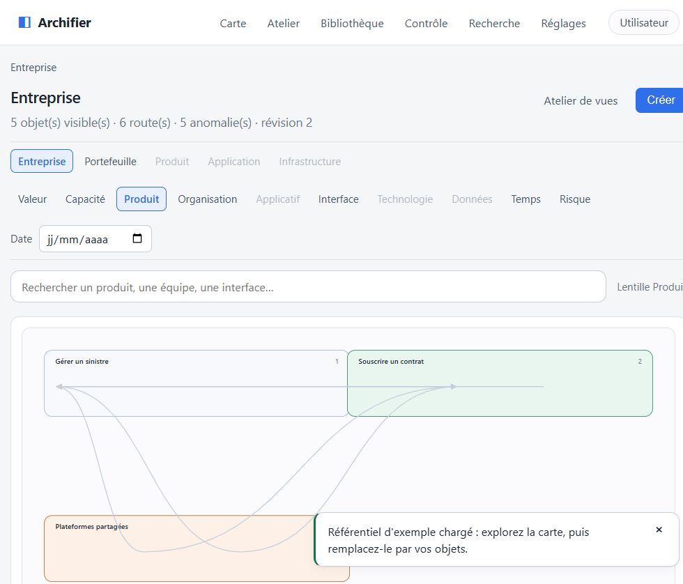

# Audit UX — Archifier v0.4

| | |
|---|---|
| **Date** | 19 novembre 2026 |
| **Périmètre** | Carte de l'entreprise, pages d'objet, Bibliothèque, Contrôle, Recherche, Réglages, Atelier |
| **Build audité** | `http://127.0.0.1:4173` (référentiel d'exemple assurance) + `http://localhost:4173` (origine vierge, pour l'onboarding) |
| **Méthode** | Parcours des routes, inspection du DOM et de l'arbre d'accessibilité, Lighthouse, lecture croisée de l'ADR-023, de `docs/ui-spec.md`, de C-10 et du code |
| **Verdict** | **L'intention est bonne ; l'enchaînement ne raconte pas encore l'entreprise.** Le « décousu » n'est pas une impression de goût : il vient de trois ruptures précises, dont un bug de rendu qui vide la carte. |

> **Audit historique — build du 19/11/2026.** Il décrit l'état observé avant ADR-024/025 et
> avant les corrections d'accueil. Ce n'est pas la spécification courante : la cible est
> fixée par ADR-023/024/025, `docs/ui-spec.md` et C-10.

> **Note de synthèse**
>
> - Cohérence de l'architecture de l'information : **2 / 5**
> - Navigation et enchaînement : **1,5 / 5** (le parcours central est bloqué par un bug)
> - Contenu des écrans : **2 / 5**
> - Confiance dans les données affichées : **1 / 5**
> - Qualité visuelle et système de design : **4 / 5**
> - Onboarding : **2 / 5**

---

## 0. Correctifs appliqués le 20 novembre 2026

Les points P0 et les incohérences P1 les plus visibles ont été corrigés et rejoués dans le navigateur.

| Correctif | État |
|---|---|
| Les nœuds de la carte sont rendus en SVG (`<g role="link">`, clavier, focus) | **Fait** |
| Les quartiers sont cliquables (L0 → L1, fiche value stream, fiche produit/application) | **Fait** |
| La carte n'est plus une image unique : les nœuds et les routes sont exposés et activables au clavier | **Fait** |
| La recherche globale indexe les objets de la carte (produits, équipes, applications, capacités, interfaces, nœuds, value streams) | **Fait** |
| Contrôle et Réglages lisent le référentiel de la carte (compteurs, inventaire, signaux) | **Fait** |
| Les combinaisons `scope`/`level` invalides sont corrigées (`MAP-002`) au lieu d'afficher un faux état vide | **Fait** |
| Distinction « référentiel vide » / « périmètre vide à ce niveau » / « pas encore de produit » | **Fait** |
| Badges de la lentille Interface alignés sur la légende | **Fait** |
| Bibliothèque : interfaces, capacités, nœuds et inventaire complet | **Fait** |
| Fiche produit : les signaux des applications utilisées remontent sur le produit | **Fait** |
| Fiche produit : complétude séparée des signaux, avec actions pour rattacher un value stream ou une capacité | **Fait** |
| Carte : les signaux de complétude ne gonflent plus le compteur de signaux | **Fait** |
| Fiche application : état vide correct, signaux, libellés de formulaires | **Fait** |
| Interface : ajout d'un consommateur versionné (les routes peuvent enfin être créées) | **Fait** |
| Navigation globale : état actif et `aria-current` | **Fait** |
| Contraste, `tablist` invalide, raisons des contrôles désactivés | **Fait** |
| Atelier : « domaine » renommé en « périmètre de vue », import honnête, explication du périmètre | **Fait** |
| Lighthouse accessibilité | **1,00** (contre 0,90) |

**Reste ouvert** (voir §4 et §6) : géographie stable entre les niveaux, lentille Organisation/Temps, mini-carte sur les fiches, actions contextuelles restantes (changer le cycle de vie, exposer une interface, analyse d'impact), fils d'Ariane, curseur temporel.

---

## 1. Ce qui fonctionne déjà

Il ne faut pas jeter le bébé avec l'eau du bain. Le socle est propre :

- **Direction artistique calme et lisible** : tokens, cartes, typographie, espacements. L'application ne ressemble pas à un tableur.
- **Routage par fragment stable**, deep links `#/map?scope=…&level=…&lens=…`, retour navigateur.
- **Création inline** dans la carte, sans modal, avec un vocabulaire de formulaire clair. C'est la bonne intuition.
- **Panneau de route** : cliquer une arête ouvre les interfaces, versions et états. C'est le seul endroit où le graphe devient réellement actionnable.
- **Export complet** : le snapshot JSON contient bien `map` (produits, équipes, applications, interfaces…), malgré des compteurs qui disent le contraire. Les données ne sont pas perdues.
- **État vide de la carte** : la phrase « Une carte vide n'est pas une erreur » est juste, et l'absence de formulaire de domaine au premier lancement est la bonne décision.
- **Pages d'objet** : les fiches produit, équipe, application, interface, capacité existent et sont reliées entre elles. La matière est là.

---

## 2. Les trois ruptures qui créent le « décousu »

### Rupture 1 — La carte ne peint pas ses objets

C'est le point le plus grave, et ce n'est pas subjectif.

**Constat visuel** : à `#/`, on voit trois quartiers vides, des compteurs (`1`, `2`, `2`) et des flèches qui traversent le vide. Les cinq produits, six applications, etc. ne sont pas dessinés.



**Constat DOM** : tous les nœuds existent, mais sont des `HTMLAnchorElement` dans le namespace XHTML, placés à l'intérieur d'un `<svg>` :

```text
a.map-node
  constructor: HTMLAnchorElement
  namespaceURI: http://www.w3.org/1999/xhtml
  getBoundingClientRect(): width 0, height 0
```

Les quartiers et les arêtes sont créés en SVG et se peignent. Les nœuds sont créés en HTML et ne se peignent pas. Le code fautif est dans `crates/ui/src/map/page.rs` (rendu des nœuds, `<a>` à l'intérieur du `<svg>`).

**Conséquences en cascade** :

1. Impossible de cliquer un produit pour zoomer vers L2.
2. Impossible de cliquer une application pour aller vers L3.
3. Les lentilles changent la légende, mais comme les nœuds sont invisibles, **changer de lentille ne produit aucun effet perceptible**.
4. La carte ressemble à un schéma inachevé ; l'utilisateur ne peut pas faire confiance à l'écran pivot.
5. Les liens existent dans le DOM et dans la « liste accessible », mais l'interface ne les montre pas.

Ce n'est pas un problème de hiérarchie visuelle : c'est un **bug de rendu SVG**. Tant qu'il est là, le parcours « de la big picture à l'infrastructure » ne peut pas fonctionner.

**En plus**, les quartiers ne sont pas cliquables : le code les rend en `<g>` sans gestionnaire de clic. Or la spécification attend « clic quartier → L1 ». Aujourd'hui, le seul chemin vers L1 est l'onglet « Portefeuille ».

### Rupture 2 — Deux référentiels et deux vocabulaires cohabitent

Le dépôt contient un modèle historique MVP3 (`domains`, `elements`, `diagrams`) et un modèle v0.4 (`map`: produits, équipes, applications, interfaces, nœuds). Les deux sont persistés dans le même snapshot, mais **les écrans ne lisent pas le même modèle**.

| Écran | Ce qu'il lit réellement | Ce que l'utilisateur voit |
|---|---|---|
| Carte, fiches produit/équipe/application/interface | `Dataset::map` | Les objets v0.4 |
| Recherche globale | index historique (`repo().search`) | **Aucun résultat pour « Parcours »**, alors que deux produits portent ce nom |
| Contrôle > Anomalies | domaines historiques | **0 anomalie**, alors que la carte en affiche 5 |
| Contrôle > Inventaire | `all_objects()` historique | **0 objet**, alors que la carte en affiche 5 |
| Réglages > Contenu | compteurs historiques | **0 objets**, alors que l'export contient bien la carte |
| Bibliothèque > Produits / Équipes | `map_inventory()` | Fonctionne |
| Bibliothèque > Interfaces / Objets | dépôt historique | **Vide**, alors que la carte affiche 6 routes et une interface |
| Atelier | domaines et vues historiques | Demande de créer un **domaine** qui n'existe pas dans la carte |

**Preuves observées** :

- Référentiel d'exemple chargé : la carte affiche `5 objet(s) · 6 route(s) · 5 anomalie(s)`.
- `#/search` avec « Parcours » : « Aucun résultat. Le référentiel ne contient peut-être pas ce concept. »
- Pourtant, la recherche **interne à la carte** trouve « Parcours Sinistre » et « Parcours Souscription ».
- `#/control` : `0 domaines · 0 éléments · 0 interfaces · 0 vues` et « Aucune anomalie détectée. »
- `#/settings` : `0 domaines · 0 éléments · 0 relations · 0 interfaces…` alors que le snapshot exporté contient le produit et l'équipe.
- `#/library/interfaces` : vide, alors que la fiche produit et la carte listent « Sinistre API ».

**Le mot « domaine » a trois sens différents** :

1. **Domaine métier** = classification (Assurance Habitation, Paiements) dans la carte.
2. **Domaine d'atelier** = périmètre d'authoring MVP3, demandé au premier lancement de l'Atelier.
3. **Domaine** = compteur historique dans Contrôle et Réglages (`0 domaines`).

Résultat : l'utilisateur crée une équipe et un produit dans la carte, puis ouvre l'Atelier et lit :

> « Aucun domaine n'existe encore. Nommez le premier domaine, puis créez votre première vue. »

Deux clics plus tôt, la carte affirmait :

> « Aucun formulaire de domaine n'est demandé. »

Les deux phrases sont dans le même produit. C'est exactement le sentiment de décousu.

### Rupture 3 — Les pages d'objet sont des tableaux de bord, pas des étapes du parcours

Une page d'objet devrait être un **zoom de la carte avec une fiche** : on garde le contexte, on voit l'objet dans son environnement, puis on agit. Aujourd'hui, c'est une grille de cartes, sans carte, avec des actions disparates.

**Produit** (`#/products/:id`) :

- Pas de carte du produit, alors que la page est le niveau L2. Un simple bouton « Voir la carte L2 » renvoie ailleurs.
- « Anomalies du produit : Aucune anomalie sur ce produit. » alors que la carte affiche 5 anomalies `PRD-006`, dont 4 applications utilisées par ce produit. La page dit aussi : « Une application partagée est un couplage, pas une anomalie cachée. » Or la carte la classe en **anomalie**. Le produit se contredit.
- Un produit tout juste créé reçoit **4 anomalies** (`PRD-002`, `PRD-003`, `PRD-032`, `PRD-033`) et la page n'offre aucun moyen d'en corriger trois : pas de rattachement de value stream, pas d'ajout de capacité, pas de création d'application.
- Le formulaire d'ajout d'application est un `select` sans label, suivi d'un bouton « Utiliser cette application » : on ne sait pas s'il s'agit d'un usage, d'un rattachement ou d'une substitution.
- « Page équipe » puis le nom de l'équipe juste en dessous : deux lignes pour la même destination.
- Les codes `PRD-005/020`, `PRD-032`, `PRD-033` sont dans le texte principal, pas dans un détail technique.

**Application** (`#/applications/:id`) :

- « Application feuille assumée (COTS/SaaS) : aucun composant (PRD-021) » pour une application **Interne**. Le message est faux : une application interne sans composant est un travail en cours, pas une application feuille assumée.
- « Interfaces fournies » est une carte **vide**, sans état vide ni action.
- « Déploiement » propose un `select` de nœuds sans label et un bouton « Déployer ». On ne sait pas si l'application est déjà déployée ou si le bouton ajoute un déploiement.
- Aucune section « Anomalies », alors que les couplages concernent l'application.

**Interface** (`#/interfaces/:id`) :

- La carte « Contrat » ne contient aucun contrat. Pour une interface non HTTP, la spec attend « Aucun contrat OpenAPI » ; ici, le titre promet un contrat qui n'existe pas.
- « 0 consommateur(s) », mais **aucune action pour ajouter un consommateur**. La fonction `map_add_interface_consumption` existe côté dépôt, mais n'est appelée nulle part dans l'UI.
- Conséquence : sur un référentiel neuf, on peut créer une interface et une version, mais **jamais une consommation**. Donc jamais de route, jamais de graphe. La carte reste une collection de boîtes.

**Value stream** :

- L'équipe propriétaire n'apparaît pas dans le bandeau.
- Les trois étapes répètent le même produit et les mêmes capacités. On ne comprend pas la contribution propre de chaque étape.
- Aucune bande d'étapes dans la carte L0/L1, alors que la spec en fait la grammaire du value stream.

**Capacité** :

- « Capacité de niveau 1 · Critique · maturité 3 » : pas d'échelle de maturité, pas de hiérarchie, pas de couverture, pas d'écarts. La page est une liste de trois relations.

**Équipe** :

- « Interfaces fournies » et « Interfaces consommées » sont des titres vides, sans état vide.
- Aucune dépendance d'équipe, aucun mode d'interaction, aucun signal de charge, alors que la spec les demande.

**Infrastructure** :

- « Applications déployées » apparaît deux fois (compteur puis titre).
- Pas de résilience, d'obsolescence, de coûts, d'incidents.
- « Voir la carte L4 » depuis un nœud affiche tous les nœuds de l'environnement, pas les applications déployées sur ce nœud.

**Fil d'Ariane** :

- Produit : `Entreprise › value stream › produit`.
- Application : `Entreprise › application` (le produit consommateur disparaît).
- Interface : `Entreprise › interface` (le fournisseur disparaît).
- Équipe : `Entreprise › équipe` (l'unité d'organisation disparaît).
- Produit plateforme : `Entreprise › Non rattaché (PRD-033) › Tarification`. Un code d'anomalie devient un lieu géographique.

---

## 3. Revue de l'enchaînement, écran par écran

| Route | Ce que l'architecte attend | Ce qui se passe | Verdict |
|---|---|---|---|
| `#/` | Carte L0 : quartiers, produits, routes, clic pour zoomer | Quartiers vides, flèches flottantes, nœuds invisibles, quartiers non cliquables | **KO** |
| `#/map?level=PORTFOLIO` | Zoom L1 : produits du portefeuille, plateformes, interfaces | Un quartier « Entreprise » + « Plateformes partagées » ; les value streams ont disparu | **Partiel** |
| `#/products/:id` | Fiche + carte L2 + actions contextualisées | Dashboard 4 cartes, pas de carte, anomalies contradictoires, actions incomplètes | **Partiel** |
| `#/applications/:id` | Composants, interfaces, déploiement, consommateurs | État vide faux pour une app interne, carte « Interfaces fournies » vide | **Partiel** |
| `#/interfaces/:id` | Identité, versions, contrat, consommateurs | Pas d'ajout de consommateur, carte « Contrat » vide | **Incomplet** |
| `#/value-streams/:id` | Étapes, produits, capacités, propriétaire | Pas de propriétaire, étapes répétitives, pas de bande d'étapes | **Partiel** |
| `#/capabilities/:id` | Hiérarchie, couverture, écarts | Trois listes, pas de hiérarchie ni de couverture | **Incomplet** |
| `#/teams/:id` | Produits, applications, interfaces, dépendances | Listes correctes, titres vides, pas de dépendances | **Partiel** |
| `#/infrastructure/:id` | Où tourne quoi, obsolescence, incidents | Applications déployées en double, pas de résilience | **Incomplet** |
| `#/library` | Recherche transversale de tous les objets | « Vues » vide par défaut ; interfaces et objets vides ; produits/équipes OK | **Incohérent** |
| `#/control` | Anomalies et inventaire de tout le référentiel | 0 objet, 0 anomalie | **Faux** |
| `#/search` | Recherche globale | Ne trouve aucun produit ni équipe | **Faux** |
| `#/atelier` | Édition de vues ancrée dans le référentiel | Autre monde, verrouillé par un « domaine » MVP3 | **Hors parcours** |
| `#/settings` | Préférences et administration | Stockage, compteurs faux, couverture de métamodèles | **À renommer** |
| `#/map?scope=VALUE_STREAM:<id>&level=PRODUCT` | Refus clair ou correction vers le portefeuille | Affiche « Votre entreprise n'a pas encore de carte » sur un référentiel plein | **Grave** |
| `#/map?scope=ENTERPRISE&level=INFRASTRUCTURE` | L4 ou explication en tête de carte | Retombe silencieusement sur L0 ; la raison est enterrée dans « Anomalies » | **Confus** |

---

## 4. Problèmes prioritaires

### P0 — à corriger avant toute démonstration

1. **Les nœuds de la carte ne sont pas rendus.**
   - Preuve : `a.map-node` = `HTMLAnchorElement`, `0 × 0`, dans un `<svg>`.
   - Impact : le parcours central est mort.
   - Reco : rendre les nœuds en `<g>` SVG avec `role="link"`, `tabindex="0"`, clic et clavier, ou utiliser l'élément `a` du namespace SVG. Ajouter un test de non-régression : largeur du nœud > 0 et clic → `#/products/:id`.

2. **Les quartiers ne sont pas cliquables.**
   - Impact : L0 → L1 dépend uniquement de l'onglet « Portefeuille », contrairement à la promesse « la carte se parcourt ».
   - Reco : ajouter le clic clavier/souris sur le quartier et un affordance visuelle.

3. **La recherche globale ignore les objets de la carte.**
   - Preuve : « Parcours » → aucun résultat, alors que deux produits portent ce nom.
   - Impact : l'utilisateur ne peut pas retrouver ce qu'il voit.
   - Reco : construire un index unique (ou fusionner `map_search` et la recherche historique) et l'utiliser partout.

4. **Contrôle et Réglages comptent un autre référentiel.**
   - Preuve : 0 objet, 0 anomalie en Contrôle ; 5 objets, 5 anomalies sur la carte.
   - Impact : perte de confiance immédiate.
   - Reco : les compteurs et l'inventaire doivent lire la carte ; à défaut, les supprimer ou les étiqueter explicitement « héritage MVP3 ».

5. **Un niveau incompatible produit un faux état vide.**
   - Preuve : `scope=VALUE_STREAM&level=PRODUCT` affiche « Votre entreprise n'a pas encore de carte » alors que le référentiel est rempli.
   - Impact : l'utilisateur croit avoir perdu ses données.
   - Reco : distinguer `map_is_empty()` (référentiel vide) de `projection.nodes.is_empty()` (périmètre vide à ce niveau). Afficher « Ce périmètre n'a pas d'objet à ce niveau » + retour au niveau compatible. Ne jamais proposer « Créer une équipe » dans ce cas.

6. **Le premier parcours ne mène nulle part.**
   - Créer une équipe → on atterrit sur la fiche équipe, sans « prochaine étape ».
   - Retour à la carte : elle affiche encore « Votre entreprise n'a pas encore de carte » et propose de créer une équipe.
   - Créer un produit → 4 anomalies, sans action pour en corriger 3.
   - Ouvrir l'Atelier → « Nom du premier domaine ».
   - Impact : le nouvel utilisateur fait trois fois le tour du produit sans jamais voir une carte.
   - Reco : rail d'onboarding persistant dans la carte, avec progression et prochaine action ; rester sur la carte après chaque création ; ne pas traiter la complétude comme une anomalie.

### P1 — cohérence et confiance

7. **Les anomalies se contredisent et ne mènent à rien.**
   - 5 × `PRD-006` dans la carte, « aucune anomalie » sur le produit, 0 en Contrôle.
   - Pas de lien depuis l'anomalie vers l'objet.
   - Le produit dit qu'un couplage n'est pas une anomalie ; la carte l'appelle anomalie.
   - Reco : un seul catalogue, une sévérité, un lien « Voir l'objet », et séparer **couplage** (signal) de **violation** (anomalie). Mettre les codes en détail, pas dans la phrase.

8. **Les lentilles sont inertes ou incohérentes.**
   - Changer de lentille ne change que la légende (les nœuds étant invisibles).
   - La lentille « Organisation » affiche `Équipe A/B/C` alors que le modèle hash 6 équipes et que la légende n'en montre que 3.
   - La lentille « Temps » réutilise les états de cycle de vie (`En run`, `En construction`, `En retrait`) au lieu des états temporels `ACTIVE / SCHEDULED / EXPIRED`.
   - À L2, la légende « Interface » parle de nombre d'interfaces, mais les badges des nœuds affichent « 2 produits ».
   - Reco : légende générée depuis les données réelles, tous les buckets, badges cohérents avec la lentille, et un vrai encodage du temps.

9. **La géographie change quand on zoome.**
   - Le même produit est à `x=62` à L0 et `x=238` à L1.
   - À L1, les quartiers de value stream disparaissent au profit d'un quartier « Entreprise ».
   - Reco : conserver les ancres et les quartiers à travers les niveaux ; le zoom doit changer la requête et le détail, pas la position.

10. **La Bibliothèque n'est pas une bibliothèque.**
    - L'onglet par défaut « Vues » est vide alors que le référentiel contient 5 produits, 5 équipes et 3 domaines.
    - Les interfaces et les objets sont vides ; les produits et équipes fonctionnent.
    - 10 onglets sans compteurs, sans filtres par type, sans recherche sur les objets.
    - Reco : soit une recherche unifiée (une seule barre + facettes), soit des onglets avec compteurs et données réelles. Le défaut ne doit pas être l'onglet le plus vide.

11. **L'Atelier est un autre produit.**
    - Il demande un domaine, crée une vue liée à ce domaine, et ignore produits, équipes, applications.
    - « Importer une vue » pointe vers `#/control/exports`, qui importe un snapshot, pas une vue.
    - La vue créée n'est rattachable à aucun produit.
    - Reco : ouvrir l'Atelier avec un contexte (`Créer une vue pour ce produit`), ou proposer « Vue libre » sans domaine ; renommer « domaine d'atelier » en « périmètre de vue » ; corriger le lien d'import.

12. **Les pages d'objet n'ont pas d'actions là où le problème est vu.**
    - Pas d'ajout de capacité, de value stream, de domaine métier depuis le produit.
    - Pas d'ajout de consommateur depuis l'interface.
    - Pas de hiérarchie de capacité.
    - Reco : un menu d'actions contextuel par type d'objet, aligné sur les sections. Une action = une intention, pas un `select` anonyme.

13. **La navigation globale ne dit pas où l'on est.**
    - Aucun item du menu n'a d'état actif (`aria-current`, classe).
    - « Recherche » et « Réglages » sont au même niveau que « Carte » et « Atelier ».
    - Pas de `Ctrl/Cmd+K` global.
    - Reco : `aria-current` sur tous les espaces, recherche en palette globale, et séparer les surfaces produit des utilitaires.

14. **Les libellés trahissent l'implémentation.**
    - `objet(s)`, `route(s)`, `anomalie(s)`, `1 produit(s)` : pluriels entre parenthèses.
    - `état ACTIVE` en anglais à côté de `Publiée` en français.
    - `PRD-005/020`, `MAP-004`, `PRD-033` dans le texte principal.
    - Textes méta : « Aucune fenêtre modale, aucun changement de contexte », « Une carte vide n'est pas une erreur ».
    - Reco : une passe de copie produit ; les codes en infobulle/détail ; les pluriels gérés ; les états traduits.

### P2 — finition

15. **Accessibilité** : Lighthouse 0,90 ; contrastes insuffisants (3,98 sur les onglets actifs, 4,2 sur le sous-titre), `role="tablist"` contenant des `<a>`, `aria-required-children`. La carte est `role="img"` : les liens internes ne sont pas exposés. Les arêtes sont cliquables à la souris seulement. Les contrôles désactivés sont focusables et leur raison n'est que dans un `title`.
16. **Carte** : pas de zoom/pan, labels minuscules à 980 px, pas de « fit », toast qui recouvre un quartier, libellé « Lentille Produit » coupé à droite.
17. **Contrôle du temps** : champ date vide, pas de « Aujourd'hui », pas d'« Effacer », pas de légende temporelle dans la barre d'état.
18. **Réglages** : c'est de l'administration (stockage, export, métamodèles), pas des préférences. Le nom promet autre chose.
19. **Marque** : le tagline « L'atelier de vues d'architecture » contredit la cible « la carte produit de l'entreprise ».

---

## 5. Le parcours cible que je recommande

### 5.1 Principe

> On ne visite pas des écrans ; on traverse une entreprise.

La carte est la seule géographie. Les pages d'objet sont des **zooms documentés**. L'Atelier est un **mode d'écriture**. Le Contrôle est un **mode de gouvernance**. La Recherche est **transversale**. Ces quatre modes ne doivent jamais raconter des référentiels différents.

```text
Carte L0
  quartier (value stream / portefeuille) ──clic──▶ L1
  produit ──clic──▶ L2
  application ──clic──▶ L3
  nœud ──clic──▶ L4
  panneau latéral : aperçu, interfaces, actions, « Ouvrir la fiche »
  Cmd/Ctrl+K : tous les objets, au même endroit

Fiche d'objet
  bandeau : identité, cycle de vie, criticité, équipe, complétude
  mini-carte : l'objet dans son contexte (pas un dashboard)
  sections : Valeur · Capacités · Applications · Interfaces · Données · Équipe · Risques
  actions contextuelles : ajouter, rattacher, exposer, changer l'état, ouvrir une vue

Atelier
  « Créer une vue pour ce produit / cette capacité » ou « Vue libre »
  plus de domaine obligatoire ; le périmètre de vue est un contexte, pas une taxonomie

Contrôle
  Signaux (couplages, complétude, obsolescence) + Inventaire + Exports
  chaque signal pointe vers l'objet et propose l'action

Recherche
  un seul index : produits, équipes, value streams, capacités, applications,
  interfaces, nœuds, domaines, vues, stories, revues
```

### 5.2 Les cinq règles à tenir

1. **Un seul index, un seul vocabulaire.** Tout écran qui affiche un objet lit le même référentiel. Les compteurs doivent être vrais.
2. **Une question par écran.** L0 : « à quoi ressemble mon entreprise ? » ; L2 : « que vend ce produit et qui le sert ? » ; L3 : « de quoi est faite cette application ? » ; Contrôle : « qu'est-ce qui ne va pas ? ».
3. **Lire et agir au même endroit.** Si une page montre une lacune, elle propose l'action qui la comble. Pas de renvoi vers un formulaire générique.
4. **La complétude n'est pas une anomalie.** « Découverte », « sans application », « sans capacité » sont des états normaux d'un produit jeune. Les afficher comme des signaux de progression, pas comme des erreurs.
5. **Le vocabulaire est celui de l'architecte, pas du contrat.** Les codes sont des détails d'implémentation. L'utilisateur lit « application partagée par 3 produits », pas « PRD-006 ».

### 5.3 Onboarding en trois gestes, dans la carte

```text
┌ Première carte ─────────────────────────────────────────────┐
│ 1. Créer une équipe        ✔                                │
│ 2. Créer un value stream   →  « Souscrire un contrat »      │
│ 3. Créer un produit        →  rattaché au value stream      │
└──────────────────────────────────────────────────────────────┘
```

- Après chaque création, **rester sur la carte**, mettre à jour le rail, surligner l'étape suivante.
- Le produit peut être créé sans valeur stream, mais il apparaît dans une zone neutre « Hors value stream » — pas dans une anomalie `PRD-033`.
- La fiche produit propose ensuite « Ajouter une application », « Rattacher une capacité », « Exposer une interface ».
- L'Atelier n'est jamais un détour obligatoire du premier parcours.

---

## 6. Plan de correction

### Sprint 1 — Rendre la carte utilisable (1 semaine)

- Corriger le rendu SVG des nœuds et ajouter un test de clic.
- Rendre les quartiers cliquables.
- Corriger les combinaisons `scope`/`level` invalides (soit désactiver, soit corriger avec un bandeau).
- Séparer « référentiel vide » et « périmètre vide à ce niveau ».
- Unifier la recherche globale (produits, équipes, interfaces, applications) et ajouter `Cmd/Ctrl+K`.
- Ajouter l'état actif de la navigation.

### Sprint 2 — Rendre les chiffres crédibles (1 semaine)

- Brancher Contrôle et Réglages sur la carte + l'héritage, avec libellés explicites.
- Unifier les anomalies : une liste, un lien, une sévérité, un code en détail.
- Séparer couplages et violations ; arrêter d'afficher 5 anomalies sur le référentiel de démonstration.
- Corriger les compteurs et les pluriels.

### Sprint 3 — Rendre les pages d'objet actionnables (1 à 2 semaines)

- Mini-carte de contexte + fil d'Ariane réel sur chaque fiche.
- Menu d'actions par type d'objet.
- Ajout de consommateur d'interface (le chaînon manquant pour que les routes existent).
- Hiérarchie de capacité et couverture.
- États vides corrects pour application interne, interfaces, équipe.

### Sprint 4 — Réconcilier l'Atelier (1 à 2 semaines)

- Ouvrir l'Atelier avec un contexte produit/application/capacité.
- Supprimer le verrou « nom du premier domaine ».
- Renommer ou retirer le concept de domaine d'atelier.
- Corriger « Importer une vue ».
- Rattacher les vues authored aux objets v0.4.

### Sprint 5 — Finition (en continu)

- Géographie stable L0 → L4, étapes de value stream dans la carte.
- Lentilles réellement encodées et légendées depuis les données.
- Accessibilité : contraste, `tablist`, clavier sur la carte, raisons des contrôles désactivés.
- Copie produit, i18n, marque.

---

## 7. Détails techniques utiles à l'équipe

| Sujet | Fichier / ligne | Constat |
|---|---|---|
| Nœuds SVG | `crates/ui/src/map/page.rs` (rendu des nœuds) | `<a>` HTML dans `<svg>` → `HTMLAnchorElement` 0×0 ; remplacer par `<g role="link" tabindex="0">` ou l'élément SVG `a` |
| Quartiers | `crates/ui/src/map/page.rs` (rendu des quartiers) | `<g>` sans `on:click` ni clavier |
| État vide | `crates/ui/src/map/page.rs:241` | `nodes.is_empty() && districts.is_empty()` confond référentiel vide et périmètre vide |
| Niveaux | `crates/core/src/map.rs:310-322` | `ValueStream` autorise `Product` ; l'onglet change le niveau sans changer le scope |
| Projection L1 | `crates/core/src/map.rs:2487` | scope entreprise → un seul quartier « Entreprise », les value streams disparaissent |
| Légendes | `crates/core/src/map.rs:2176-2225` | légendes statiques ; « Organisation » = Équipe A/B/C ; « Temps » = cycle de vie |
| Recherche | `crates/ui/src/views/search.rs:25` | `repo().search()` historique uniquement |
| Contrôle | `crates/ui/src/routes/control.rs:51-59, 90` | domaines historiques + `all_objects()` ; ignore `map_anomalies()` |
| Réglages | `crates/ui/src/views/settings.rs:118` | compteurs historiques |
| Bibliothèque | `crates/ui/src/routes/library.rs:156-158, 261` | interfaces via dépôt historique ; produits/équipes via `map_inventory()` |
| Atelier | `crates/ui/src/routes/atelier.rs:48-67, 204` | domaine obligatoire ; import de vue → `#/control/exports` |
| Produit | `crates/ui/src/map/pages.rs:132` | anomalies filtrées sur `object_id == produit` ; les `PRD-006` sont portées par les applications |
| Application | `crates/ui/src/map/pages.rs:882` | « application feuille assumée » même pour une application interne |
| Interfaces | `crates/ui/src/map/pages.rs:906` | `<ul>` vide sans état vide |
| Consommation | aucune occurrence UI | `map_add_interface_consumption` existe mais n'est jamais appelée |

---

## 8. Décisions produit à prendre

1. **L'Atelier reste-t-il un espace autonome ou devient-il contextuel ?** Aujourd'hui, il est autonome et parle une autre langue. La cible « la carte est le point d'entrée, l'Atelier est la surface d'édition » suppose un pont. Sinon, il faut assumer deux produits.
2. **Le « domaine » d'atelier doit-il disparaître ?** Si oui, il faut migrer les vues et retirer le formulaire. Si non, il faut le renommer et expliquer sa différence avec le domaine métier.
3. **Un produit peut-il exister sans value stream ?** Si oui, la zone « Hors value stream » est neutre, pas une anomalie. Si non, l'onboarding doit l'exiger dès le premier écran.
4. **Les applications partagées sont-elles des anomalies ?** La carte et la fiche produit ne répondent pas la même chose. Il faut trancher : signal de couplage, pas anomalie de conformité.
5. **La Bibliothèque est-elle un espace ou une recherche ?** 10 onglets vides ne remplacent pas un index. Je recommande une recherche unifiée avec facettes, et de garder la Bibliothèque comme vue de cette recherche.
6. **Quel est le seul index de référence ?** La carte (`Dataset::map`) me semble le bon candidat. L'héritage MVP3 doit s'y raccrocher ou être explicitement rangé dans une section « historique ».

---

## 9. Preuves

- Carte L0, référentiel d'exemple, **avant correctif** : quartiers vides et flèches flottantes — `docs/ux-audit-assets/carte-L0.jpeg`.
- Fiche produit, **avant correctif** : dashboard sans carte, signaux absents, `select` non labellisé — `docs/ux-audit-assets/page-produit.jpeg`.
- Lighthouse sur `#/` : accessibilité **0,90**, bonnes pratiques 1,00, SEO 0,75 ; échecs `color-contrast` (3,98 / 4,2) et `aria-required-children` (`role="tablist"` avec des `<a>`).
- Snapshot exporté : contient bien `map.products` et `map.teams` ; les compteurs de l'UI sont donc faux, pas les données.
- DOM : `a.map-node` → `HTMLAnchorElement`, namespace XHTML, `0 × 0` (produits et applications, tous niveaux).
- Recherche globale « Parcours » → aucun résultat ; recherche interne à la carte → 2 produits.
- `#/map?scope=VALUE_STREAM:<id>&level=PRODUCT` → « Votre entreprise n'a pas encore de carte » sur un référentiel rempli.
- `#/map?scope=ENTERPRISE&level=INFRASTRUCTURE` → retour L0, raison `MAP-002` dans les anomalies.
- Après création d'une équipe sur une origine vierge : la carte affiche encore « Votre entreprise n'a pas encore de carte » et propose de recréer une équipe.
- Après création d'un produit : 4 anomalies, aucune action pour en corriger 3 ; l'Atelier demande un domaine.

---

## 10. En une phrase

**Archifier a déjà la bonne intuition — la carte comme géographie, le produit comme unité, l'Atelier comme écriture — mais l'application est encore deux produits cousus ensemble, et la carte, qui devrait tenir les coutures, ne dessine pas ses objets.** Réparer le rendu de la carte, unifier l'index et faire des fiches des zooms actionnables suffira à faire disparaître l'essentiel du « décousu ».
